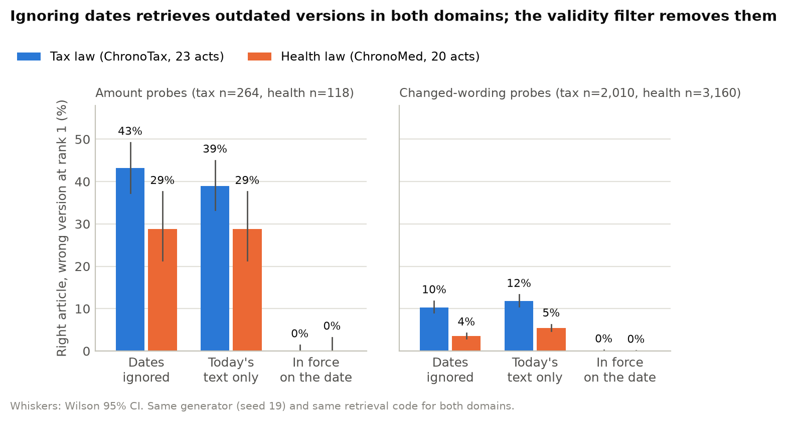
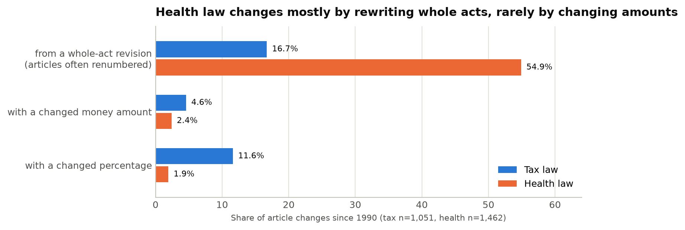
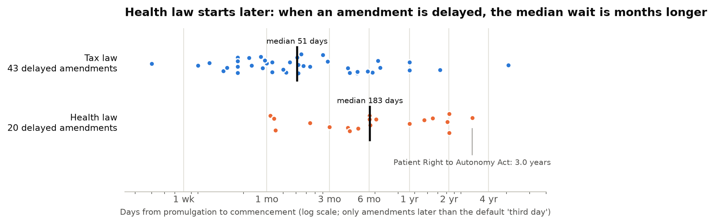
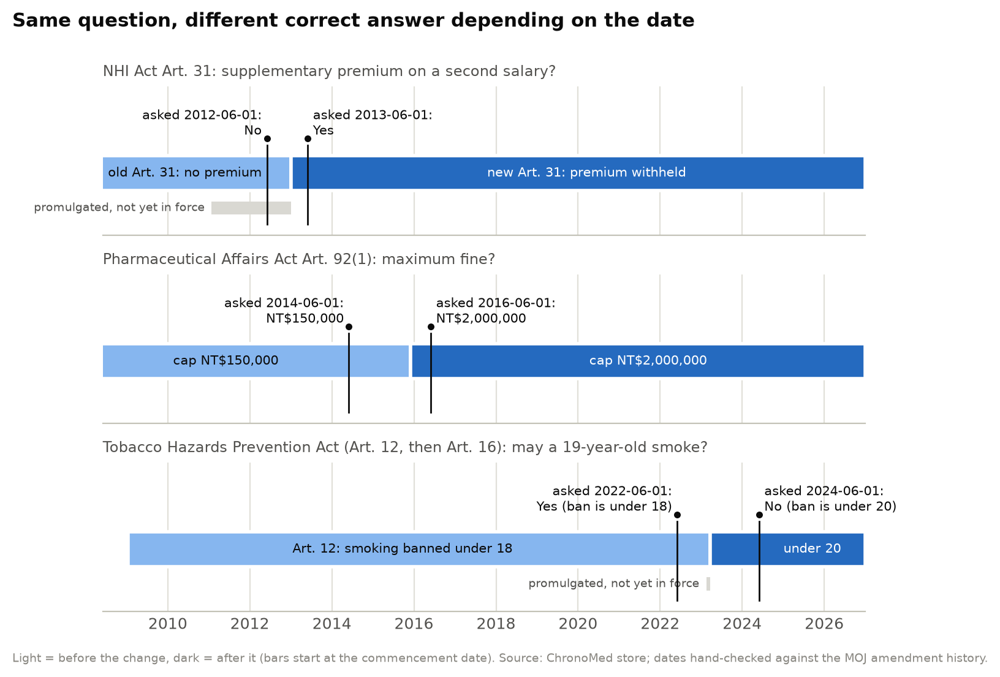

# ChronoMed-TW: does "time in the index" transfer from Taiwan tax law to Taiwan health law?

*Technical note (draft), 2026-10-23. Part of ChronoTax-TW. Zero LLM calls, CPU only.*

## Summary

ChronoTax-TW found that a retrieval index that ignores dates returns the right tax article in the wrong version for
43% of amount probes, and that an index restricted to the law in force on the date returns 0%. We ran the same
pipeline, the same probe generator and the same retrieval code on **20 Taiwanese health and medical acts**
(196 versions, 3,019 article versions). **The finding replicates in direction.** Ignoring dates gives the wrong version
for 29% of health amount probes (95% CI 21–38%). The validity filter gives 0% and raises R@1 from 0.220 to 0.585
(paired McNemar 43 vs 0, p < 0.001). **The size of the effect differs**, and the two domains differ in a way that
matters more for health AI. Health law changes mostly by rewriting whole acts (55% of article changes vs 17% in tax)
and rarely by changing amounts. Its amendments also start much later after promulgation: the median delay of delayed
amendments is 183 days, against 51 days in tax. The ChronoTax date rules therefore did not transfer unchanged. Run on
the same health data, they give a different start date for 497 of 3,019 article versions (16%), and they get 4 of 6
hand-checked official cases wrong. When a question falls between promulgation and commencement, they return a text
other than the one in force in 43% of cases. The design rule "put time in the index" transfers. The rules that compute
the time must be re-checked for each domain.

## 1. Question and why it matters

- **Question.** ChronoTax-TW concluded: *put time in the index, not in the model*. Does that conclusion hold outside
  tax law? Specifically: (a) does a date-ignoring index also return outdated versions of **health** law, and does the
  validity filter remove them? (b) do the ChronoTax rules that compute *when* each article version applies still work
  on health law?
- **Why it matters.** Clinical and insurance AI must use the rule that applied on the date of care or payment. Examples
  are National Health Insurance premiums, drug and device rules, long-term care and patient rights. A question about a
  2012 claim must be answered with the 2012 rule. A question asked in 2017 about advance decisions must be answered
  knowing that the Patient Right to Autonomy Act was promulgated (2016-01-06) but not yet in force (2019-01-06).

## 2. Data

All sources are open government data, used the same way as ChronoTax-TW:

- Every version (full text) of each act comes from **LYAPI v2** (Legislative Yuan records, CC BY 4.0).
- Promulgation dates, commencement clauses and Executive Yuan commencement orders come from the **MOJ amendment
  history** (法規沿革, law.moj.gov.tw, Open Government Data License).
- The official **MOJ English text** exists for the current version only.
- The **MOJ current Chinese text** was used for a cross-check.

Download was polite: one process, at least 1.1 s between requests, retries with back-off, everything cached and
resumable, and every request logged (`data/med/raw/fetch_log.tsv`). That log has 239 LYAPI requests (1 HTTP 429,
retried successfully) and 80 MOJ requests. A scratch script made 20 more MOJ requests early on; see §7.

**Acts.** We chose 20 acts under the Ministry of Health and Welfare with many versions or changing amounts and
conditions. Laws were matched by exact title only: the LY id comes from LYAPI `laws?主管機關=衛生福利部`, and the MOJ
pcode comes from the MOJ search page, as `src/registry.py` does.

| Act | Official English title (MOJ) | LY id | pcode | LY versions (first–last) | article versions | delayed versions |
|---|---|---|---|---|---|---|
| 全民健康保險法 | National Health Insurance Act | 01189 | L0060001 | 14 (1994–2023) | 255 | 4 |
| 醫療法 | Medical Care Act | 02533 | L0020021 | 20 (1986–2026) | 278 | 0 |
| 藥事法 | Pharmaceutical Affairs Act | 02510 | L0030001 | 20 (1970–2026) | 332 | 1 |
| 醫師法 | Physicians Act | 02508 | L0020001 | 16 (1943–2022) | 205 | 6 |
| 護理人員法 | Nursing Personnel Act | 02542 | L0020166 | 11 (1991–2023) | 121 | 0 |
| 長期照顧服務法 | Long-Term Care Services Act | 02588 | L0070040 | 4 (2015–2021) | 92 | 2 |
| 傳染病防治法 | Communicable Disease Control Act | 02516 | L0050001 | 17 (1944–2023) | 312 | 0 |
| 菸害防制法 | Tobacco Hazards Prevention Act | 02549 | L0070021 | 5 (1997–2023) | 114 | 3 |
| 食品安全衛生管理法 | Act Governing Food Safety and Sanitation | 02513 | L0040001 | 19 (1975–2019) | 265 | 0 |
| 精神衛生法 | Mental Health Act | 02526 | L0020030 | 6 (1990–2022) | 214 | 2 |
| 醫療器材管理法 | Medical Devices Act | 07121 | L0030106 | 1 (2019) | 85 | 1 |
| 病人自主權利法 | Patient Right to Autonomy Act | 02536 | L0020189 | 3 (2015–2020) | 23 | 1 |
| 安寧緩和醫療條例 | Hospice Palliative Care Act | 02562 | L0020066 | 5 (2000–2020) | 30 | 0 |
| 人體器官移植條例 | Human Organ Transplant Act | 02535 | L0020024 | 7 (1987–2020) | 64 | 1 |
| 緊急醫療救護法 | Emergency Medical Services Act | 02547 | L0020045 | 6 (1995–2012) | 147 | 0 |
| 藥害救濟法 | Drug Injury Relief Act | 02564 | L0030023 | 4 (2000–2026) | 39 | 0 |
| 罕見疾病防治及藥物法 | Prevention of Rare Diseases and Orphan Drug Act | 02563 | L0030003 | 4 (2000–2014) | 71 | 1 |
| 藥師法 | Pharmacists Act | 02509 | L0030066 | 12 (1943–2019) | 135 | 1 |
| 管制藥品管理條例 | Controlled Drugs Act | 02512 | L0030010 | 15 (1929–2017) | 187 | 0 |
| 健康食品管理法 | Health Food Governing Act | 02556 | L0040012 | 7 (1999–2019) | 50 | 1 |

*LY versions are dated by Legislative Yuan passage, so first and last years are passage years. "Delayed" means the
amendment starts later than the 中央法規標準法 §13 default (promulgation + 2 days). Source:
`data/med/results/store_stats.json` → `acts_table`.*

## 3. Method

### 3.1 Reuse first, change only what the domain needs
The original ChronoTax files were **not edited**. Everything new lives in `src/med/` and writes only to `data/med/`.

| Step | What ChronoMed does | Original code used |
|---|---|---|
| Fetch | same LYAPI calls and file layout as `fetch_ly.py`, plus rate limit and atomic writes | (copied logic) |
| Store | `build_med.py`: copy of `build_db.build()` with 6 marked changes (MED-1…6, below) | `SCHEMA`, `match_versions`, `reorder_intervals`, `effect_rules` imported unchanged |
| Store, unchanged rules | `build_med.py --tax-parser` runs **`build_db.build()` itself, unchanged**, on the same health data | everything |
| English gloss | `english_med.py` runs `english.main()` | unchanged |
| Probes | `bench_med.py` runs **`bench.main()` unchanged** (seed 19), then renames the output | unchanged |
| Retrieval | `eval_med.py` calls **`eval_retrieval.run()` unchanged**, one probe at a time (so tests can be paired) | unchanged (`main()` is never called: it would overwrite the tax results) |

A safety step in `medcfg.py` re-points every write path of the original modules to `data/med/` before any of them run.

### 3.2 Commencement rules for health law (the main change)
The tax parser applies one rule to each amendment entry: the **last** "自…施行" date in the entry, otherwise the §13
default. Health-law histories use forms that this rule misreads. `moj_med.py` keeps the original output and adds:

| Form in the MOJ history | Example | Tax parser gives | ChronoMed gives |
|---|---|---|---|
| relative date | 病人自主權利法: "自公布後三年施行" | 2016-01-08 (§13 default) | **2019-01-06** |
| "除…外" exception, last date is the exception | 食品安全衛生管理法 2014-02-05: only parts of Arts 21, 22, 30 delayed | whole amendment 2014-06-19 | 2014-02-07; the parts are flagged |
| per-article Executive Yuan order | 二代健保: "發布第27、28、35條條文定自一百零一年七月一日施行" | Arts 27/28/35 on 2013-01-01 | **2012-07-01** |
| per-chapter order | 精神衛生法 2022: 第五章 by order | whole act 2026-08-01 | main date 2024-12-14; Chapter 5 on 2026-08-01 |
| date not set yet | 藥事法 2026: Arts 27-2, 27-3, 96-1 "施行日期由行政院定之", no order yet | in force 2026-03-06 | **not in force** (old text kept) |
| line-wrap spaces inside words | "定自 一百年九月一日施行" | not matched | matched (all whitespace removed) |

Changes MED-1…6 in `build_med.py`:
1. **MED-1:** paths and act list point to `data/med/`.
2. **MED-2:** the MOJ history is parsed with the extended parser above.
3. **MED-3:** per-article dates are looked up in this order: articles or chapters named in the history entry or in
   its Executive Yuan order; then the act's own commencement article (original `effect_rules`); then the
   amendment date.
4. **MED-4:** articles whose start date is not set are kept out of force (table `pending_article`). In a full-text
   revision the old text still ends on the revision's start date.
5. **MED-5:** exceptions at paragraph level (e.g. 第4條第1項第4款) cannot be represented in an article-level store.
   The article keeps the main date and is flagged (table `partial_commencement`).
6. **MED-6:** LYAPI sometimes merges two amendments passed on the same day. In 傳染病防治法, MOJ entry 18 (Arts 61-1
   and 61-2, promulgated 2023-06-28) has no LY version of its own. The articles named by such an entry get that
   entry's own date.

Validity intervals, effective-date ordering and "overtaken" detection are the original `reorder_intervals`.

### 3.3 Probes and evaluation
- **TW-MedTime v0.** Same generator as TW-TaxTime (`bench.py`, seed 19, zero LLM calls). Four probe types:
  - *version*: (act, article, date) → the version in force;
  - *amount*: cloze text before a money amount that changed between versions;
  - *span*: cloze text containing wording inserted or deleted between versions;
  - *bitemporal*: from retroactive versions.
  Gold labels are article-version ids, checked by rule.
- **Retrieval.** The same three indexes as ChronoTax, all FTS5 trigram with BM25:
  - *static*: all versions, date ignored;
  - *latest*: today's text only;
  - *temporal*: versions in force on the probe date.

  Metrics: R@1, R@5, and **wrong version @1** (the top hit is the right article but a different version; ChronoTax
  calls this misgrounding@1). We report Wilson 95% intervals, an exact paired McNemar test for static vs temporal,
  and Newcombe 95% intervals for the tax − health difference.
- **Window probes (an extension, not in the ChronoTax generator).** For every article version since 1990 that starts
  later than the §13 default, we draw one date between promulgation and commencement. The gold answer is the text in
  force on that date, which is the previous text or "not in force yet". These probes measure exposure to delayed
  commencement, which the version probes rarely sample.
- **Tax side.** ChronoTax results were recomputed with the same code on `data/lawtw.db` and
  `data/bench/tw_taxtime_v0.jsonl`, both opened **read-only**.

## 4. Results

### 4.1 The store (same definitions for both domains)

| | Health (ChronoMed) | Health, unchanged tax rules | Tax (ChronoTax) |
|---|---|---|---|
| acts / versions | 20 / 196 | 20 / 196 | 23 / 406 |
| articles / article versions | 1,317 / 3,019 | 1,318 / 3,023 | 1,166 / 3,555 |
| LY versions not matched to an MOJ history entry | 0 | 0 | 2 |
| MOJ entries with no LY version | 1 (handled by MED-6) | 1 (not handled) | 9 |
| versions with delayed commencement | 24 (12.2%) | 10 | 46 (11.3%) |
| median delay of delayed versions (days) | 183 | 141.5 | 56 |
| versions delayed ≥ 180 days | 14 | 4 | 11 |
| article versions starting later than the default | 824 (27.3%) | 460 | 363 (10.2%) |
| retroactive versions / article versions | 0 / 0 | 0 / 0 | 4 / 54 |
| overtaken pending article versions | 6 | 2 | 4 |
| versions whose date was unknown and set to promulgation | 0 | 4 | 3 |
| article versions with a per-article date | 65 | 9 | 104 |
| articles not in force yet (pending) | 4 | – | – |
| article versions flagged for paragraph-level exceptions | 15 | – | – |
| unparsed commencement sentences: original `effect_rules`, latest commencement article | 6 (+7 relative clauses skipped without notice) | same | 11 (+1) |
| unparsed clauses: extended history parser | 0 of 197 entries | – | 2 of 413 (sunset clauses "施行期間…至…止") |

*Source: `data/med/results/store_stats.json` (`stores`, `history_forms`, `commencement_articles`). The tax column
reproduces the published ChronoTax counts exactly: 3,555 article versions, 54 retroactive, 4 overtaken.*

### 4.2 Hand-checks against the official MOJ pages
We read each official MOJ history entry by hand, wrote down the dates it gives, and compared them with each store.
This checks the parser and the store against the official wording. Both read the same MOJ page, so this is not an
independent source. One case is also confirmed by statute text: the current 菸害防制法 Art. 16 itself says
"本法中華民國九十八年一月十一日修正生效前" ("before the amendment took effect on 2009-01-11").

| Case (MOJ history entry) | What the entry says | ChronoMed | Tax rules |
|---|---|---|---|
| 全民健康保險法 2011 full revision ("二代健保"), entry 9 | Arts 27, 28, 35 from 2012-07-01 (Executive Yuan order of 2012-05-21); all others from 2013-01-01 (order of 2012-10-09) | **104/104 right** | 101/104: Arts 27/28/35 dated 2013-01-01 |
| 全民健康保險法 Art. 11 amendment of 2011-06-29, entry 10 | order of 2011-08-12: from 2011-09-01 | **1/1** | 0/1: dated 2011-06-29 |
| 菸害防制法 2023 full revision, entry 5 | from 2023-03-22; but Art. 4 ¶1 item 4 from 2023-04-01 and parts of Arts 9 and 29 from 2024-03-22 | **47/47 at article level**; Arts 4, 9, 29 flagged as paragraph exceptions | 47/47 at article level, no flags |
| 菸害防制法 2007 full revision, entry 3 | "自公布後十八個月施行" → 2009-01-11; Art. 4 date left to the Executive Yuan | **34/34**; Art. 4 kept out of force until its 2009 text (2009-06-01) | 0/34: all dated 2007-07-11 |
| 醫療器材管理法, entry 1 | order of 2021-02-17: from 2021-05-01 | **85/85** | 85/85 |
| 病人自主權利法, entry 1 | "自公布後三年施行" → 2019-01-06 | **19/19** | 0/19: all dated 2016-01-08 |

*Source: `data/med/results/handcheck.json`. URLs:
`https://law.moj.gov.tw/LawClass/LawHistory.aspx?pcode=L0060001` (NHI), `…=L0070021` (tobacco), `…=L0030106`
(devices), `…=L0020189` (patient autonomy).*

We also compared every article of each act's current MOJ text with the newest LY version, after mapping half-width
brackets and colons to full width. 1,287 of 1,294 articles are identical. Each of the 7 other articles differs by one
or two single characters, for example 污/汙, 訂/定, and 項/款 in 健康食品管理法 Art. 18 (`handcheck.json` →
`current_text`).

### 4.3 Probes

| Probe type | TW-MedTime v0 (health) | TW-TaxTime v0 (tax) |
|---|---|---|
| version | 1,925 | 1,225 |
| amount | **118** | 264 |
| span (changed wording) | **3,160** | 2,010 |
| bitemporal | **0** (no retroactive amendments) | 104 |
| acts / articles with probes | 19 / 840 | 22 / 543 |

*Source: `data/med/bench/summary_medtime.json`, `data/med/results/retrieval_side_by_side.json` → `probes`.*

### 4.4 Retrieval: does the tax finding replicate?

**Amount probes** (the ChronoTax headline):

| Index | Tax R@1 (95% CI) | Tax wrong version @1 | Health R@1 (95% CI) | Health wrong version @1 | Health R@5 |
|---|---|---|---|---|---|
| static (dates ignored) | 0.239 (0.191–0.294) | **0.432** (0.373–0.492) | 0.220 (0.155–0.303) | **0.288** (0.214–0.376) | 0.771 |
| latest (today's text) | 0.117 (0.084–0.162) | 0.390 (0.333–0.450) | 0.153 (0.099–0.228) | 0.288 (0.214–0.376) | 0.246 |
| temporal (in force on the date) | 0.697 (0.639–0.749) | **0.000** (0.000–0.014) | 0.585 (0.495–0.670) | **0.000** (0.000–0.032) | 0.932 |

**Changed-wording (span) probes:**

| Index | Tax R@1 | Tax wrong version @1 | Health R@1 | Health wrong version @1 |
|---|---|---|---|---|
| static | 0.568 (0.546–0.590) | 0.103 (0.091–0.118) | 0.639 (0.622–0.655) | 0.035 (0.029–0.042) |
| latest | 0.185 (0.169–0.203) | 0.118 (0.105–0.133) | 0.251 (0.236–0.267) | 0.054 (0.047–0.063) |
| temporal | 0.762 (0.743–0.780) | 0.000 (0.000–0.002) | 0.765 (0.750–0.780) | 0.000 (0.000–0.001) |

*Source: `data/med/results/retrieval_side_by_side.json`. The tax rows are a re-run with the same code. The published
`data/bench/results_retrieval.json` has temporal R@1 = 0.693; the re-run gives 0.697, a difference of one probe in
264. The tax database file is newer than that results file (20 Oct 08:18 vs 03:45), which is the likely cause. We did
not investigate further.*



- **Yes, in direction.** In both domains a date-ignoring index puts an outdated version of the right article first
  for a substantial share of amount probes: 43% in tax, 29% in health. The validity filter removes all of them.
- **The filter's gain is significant.** Paired McNemar on R@1, static vs temporal:
  - health amount: 43 probes only temporal correct vs 0 only static correct (p < 0.001);
  - health span: 399 vs 0 (p < 0.001);
  - tax amount: 121 vs 0.
- **Smaller than in tax.** The health wrong-version rate of the static index is lower:
  - amount: −14.4 points (Newcombe 95% CI −23.9 to −3.8);
  - span: −6.9 points (−8.4 to −5.4).
- **Robustness.** Removing the 4 amount probes on articles flagged as pending or paragraph-level leaves the result
  unchanged: static wrong version 0.298, temporal R@1 0.588, n = 114 (`medical_amount_unflagged`).

### 4.5 Where the domains differ

| | Health | Tax | Source |
|---|---|---|---|
| article changes since 1990 that come from a **whole-act revision** (articles often renumbered) | **54.9%** (803 of 1,462) | 16.7% (175 of 1,051) | `store_stats.json` → `change_profile` |
| … with a changed **money amount** | 2.4% (35) | 4.6% (48) | same |
| … with a changed **percentage** | 1.9% (28) | 11.6% (122) | same |
| amendments delayed beyond the default (MOJ histories, **same parser** for both) | 24 of 197 (12.2%) | 45 of 413 (10.9%) | `history_forms` |
| median delay of those (days) | **183** | 51 | same |
| commencement **relative** to promulgation ("自公布後N年施行") | 16 entries | 3 | same |
| entries with Executive Yuan commencement orders | 12 | 47 | same |
| retroactive article versions | **0** | 54 | `stores` |
| window probes (dates between promulgation and commencement, since 1990) | **745** (14 acts; median window 472 days) | 283 (12 acts; median 146 days) | `window_probes.json` |
| … where the law was not in force at all yet | 455 | 103 | same |





**Reading.**
- **Health law is rewritten, not tuned.** Most article changes come from whole-act revisions. Few change an amount or
  a percentage, so the generator finds fewer amount probes (118 vs 264) and more wording probes (3,160 vs 2,010).
- **That explains part of the lower wrong-version rate.** When an act is rewritten, the old and new texts share less
  wording, so the cloze query matches only one of them. We tested this on span probes. The static wrong-version rate is
  lower for pairs whose newer version is a whole-act revision:
  - health: 3.1% (n = 2,153) vs 4.4% (n = 1,007) for partial amendments;
  - tax: 5.2% (n = 480) vs 12.0% (n = 1,530).

  But health partial amendments (4.4%) are still well below tax partial amendments (12.0%). The revision share explains
  part of the gap, not all of it (`retrieval_side_by_side.json` → `*_span_static_wrong_version_by_change_kind`).
- **Time works differently.** Tax law looks backwards: retroactive amendments and tax years, which is why ChronoTax
  needed the bitemporal store. Health law looks forwards: long, often relative, delays between promulgation and
  commencement.

### 4.6 What happens if the tax date rules are reused unchanged

| Measure | Result | Source |
|---|---|---|
| article versions whose start date differs from ChronoMed | 497 of 3,019 (16.5%) | `store_stats.json` → `medical_store_comparison` |
| version probes answered with a different text by direct lookup | 66 of 1,925 (3.4%, 95% CI 2.7–4.3%): Mental Health Act 53, Food Safety 7, Tobacco 6 | `retrieval_side_by_side.json` → `medical_probes_on_tax_parser_store` |
| window probes answered with a text not in force on the date | **321 of 745 (43.1%, 39.6–46.7%)** | `window_probes.json` |
| temporal retrieval, amount probes | R@1 0.559 vs 0.585 with ChronoMed dates; wrong version @1 0.017 (2 probes) vs 0.000 | `retrieval_side_by_side.json` |
| official hand-checked cases wrong | 4 of 6 cases (二代健保 Arts 27/28/35, the NHI Art. 11 amendment, the 2007 tobacco revision, the Patient Right to Autonomy Act) | `handcheck.json` |

The version probes hide most of the problem. They sample dates uniformly inside each version's own interval, so they
rarely land in the window between promulgation and commencement. The window probes target exactly that window, and
there the unchanged rules fail almost half the time.

For reference, the extended parser was also run on the 23 tax histories (read-only). It gives a different
amendment-level date for 31 of 413 tax entries. The tax store was **not** changed. Its own per-article rules from each
act's commencement article may already correct many of these, but we did not check this by hand.

## 5. Three examples: same question, different correct answer depending on the date

All answers come from the store (`data/med/results/examples.json`) and can be checked by rule: an article version and
one number in it. Official English comes from the MOJ English text, which covers **only the current version**. Glosses
of older versions are ours.



**1. National Health Insurance: supplementary premium (insurance; delayed commencement).**
*Question:* A hospital pays a salary to a visiting doctor who is insured through another employer. Must it withhold an
NHI supplementary premium (補充保險費)?
- **Asked on 2012-06-01: no.** No article in force contains the rule. The 二代健保 text was promulgated on 2011-01-26
  but started on 2013-01-01. Art. 31 in force then was about medical services.
- **Asked on 2013-06-01: yes.** Art. 31 ¶1 item 2: 「二、非所屬投保單位給付之薪資所得。」 Official English (current
  Art. 31): "For beneficiary individuals in Categories 1 to 4 and Category 6, supplementary insurance premiums shall be
  calculated and collected … for the following types of income … 2. Salary ear[nings] …" (MOJ English, amended
  2023-06-28).
- *Indexes on 2012-06-01:* static and latest both return the 2013 Art. 31, which was not in force on that date. Only
  the temporal index correctly finds no rule in force.

**2. Pharmaceutical Affairs Act Art. 92(1): maximum fine (drugs; amount change).**
*Question:* What is the maximum fine under Art. 92 ¶1, for example for breaking the Art. 57 manufacturing rules?
- **2014-06-01: NT$150,000.** 「…處新臺幣三萬元以上十五萬元以下罰鍰。」 Our gloss: "a fine of not less than NT$30,000
  but not more than NT$150,000". Text in force 2012-06-29 → 2015-12-04.
- **2016-06-01: NT$2,000,000.** 「…處新臺幣三萬元以上二百萬元以下罰鍰。」 Official English (current): "shall be issued
  a fine of not less than NT$30,000 but not more than NT$2,000,000". In force since 2015-12-04.
- *Indexes:* static returns a 1993 version of a different article (Art. 93). Latest returns NT$2,000,000 for both
  dates, which is wrong in 2014. Temporal is right on both dates.

**3. Tobacco Hazards Prevention Act: may a 19-year-old smoke? (public health; condition change and renumbering).**
- **2022-06-01: yes.** Art. 12: 「未滿十八歲者，不得吸菸。」 Our gloss: "Persons under 18 shall not smoke."
- **2024-06-01: no.** Art. 16: 「未滿二十歲之人及孕婦，不得吸菸。」 Official English: "Persons under the age of 20 and
  pregnant women shall not smoke." In force since 2023-03-22.
- The rule also moved from Art. 12 to Art. 16, so a lookup by article number alone also fails.
- *Indexes:* static returns the 18-year rule for both dates. Latest returns the 20-year rule for both dates. Temporal
  is right on both dates.

## 6. What it means

- **The design rule transfers.** A rule-based validity filter is still exact for every probe with a known date, and it
  is cheap. Learned time-awareness was not re-tested here: the reranker study was not repeated on health law.
- **The time rules do not transfer for free.** ChronoTax's date extraction was tuned to tax histories. On health law
  it misdated a whole act by three years (Patient Right to Autonomy Act) and an 18-month revision (Tobacco 2007). It
  also put not-yet-active articles in force (Pharmaceutical Affairs Act 2026). The index is only as good as its
  commencement rules. Each new domain needs a commencement audit and hand-checks against the official text.
- **The main health-specific risk is the not-yet-in-force window.** Clinical guidance, insurance staff and hospital
  systems often read about a new rule when it is promulgated. A RAG system that indexes the newest published text
  answers with rules that do not apply yet. In our window probes this gap lasted a median of 472 days, and up to 4.7
  years for one article (藥事法 Art. 53: promulgated 1997-05-07, in force 2002-01-01).
- **For TimelyMed-style temporal mapping of clinical records**, the time of the legal rule is a second clock, next to
  the clinical timeline. A patient event in 2018 must be matched to the 2018 rule set.

## 7. Limitations

- **Probe style.** Amount and span probes are cloze-style and lexical, as in ChronoTax. Absolute R@1 values overstate
  natural-question performance; the gap between indexes is the point. Only 118 amount probes exist, hence wide CIs.
  No natural-language health questions were made (LLM cap 0).
- **Hand-checks.** The six cases were read from the official MOJ histories with AI assistance, not by a Taiwanese
  legal expert. The author does not read Chinese, so a Taiwanese reader should confirm the six readings in §4.2.
- **Article granularity.**
  - Paragraph-level commencement (菸害防制法 2023 Arts 4, 9, 29; 食品安全衛生管理法 2013/2014; 精神衛生法 Art. 81) is
    flagged but not represented.
  - Full-text revisions with staggered commencement mix two editions under one article number. Example: in the NHI
    Act, the old Art. 11 (exclusion of prisoners) ends on 2011-09-01 in the store, when the new Art. 11 started. Under
    the old edition it should have run until 2013-01-01.
- **Data gaps.**
  - LYAPI merges same-day amendments: one case, handled by MED-6.
  - 7 one-character differences exist between the LY and MOJ current texts.
  - Pre-1990 versions are in the store but not in the probes.
- **No retroactivity in this sample.** Bitemporal probes could not be generated (0 retroactive amendments). Other
  health rules are retroactive, for example the 2026-08-24 NHI payment-standard order effective 2026-01-01 (§9).
- **Scope.** Only acts are covered, not ministry regulations. 施行細則, NHI payment standards and drug reimbursement
  rules are where most clinical and insurance details live.
- **Recorded mistake.** Early on, a scratch script called the original `moj_history.fetch()` before its path was
  re-pointed. It downloaded 20 MOJ history pages into the original `data/raw/moj/` (new files only; existing files
  untouched). These were byte-for-byte the same as our cached copies and were deleted. `medcfg.py` now redirects all
  original write paths at import.
- **Tooling.** AI coding assistants wrote much of the code. Design choices and checks are documented here.

## 8. Reproduce

```bash
# from the repository root, global Python 3.12 (stdlib + matplotlib); no GPU, no LLM
python -I src/med/run_all.py --fetch        # first time: resolve ids, polite download (~15 min), then everything
python -I src/med/run_all.py                # rebuild from cache (~10 s)
# individual steps
python -I src/med/registry_med.py resolve   # LY ids + MOJ pcodes (exact titles) -> data/med/raw/{ly/lyids.json,moj/pcodes.json}
python -I src/med/fetch_med.py              # LYAPI versions, MOJ history / English / current text (cached, resumable)
python -I src/med/build_med.py              # ChronoMed store  -> data/med/medtw.db
python -I src/med/build_med.py --tax-parser # original build_db.build() on the same data -> data/med/medtw_taxparser.db
python -I src/med/english_med.py            # official English text (current version) into medtw.db
python -I src/med/stats_med.py              # -> data/med/results/store_stats.json
python -I src/med/bench_med.py              # TW-MedTime v0 -> data/med/bench/tw_medtime_v0.jsonl
python -I src/med/eval_med.py               # -> data/med/results/retrieval_side_by_side.json
python -I src/med/window_med.py             # -> data/med/results/window_probes.json
python -I src/med/handcheck_med.py          # -> data/med/results/handcheck.json
python -I src/med/examples_med.py           # -> data/med/results/examples.json
python -I src/med/figures_med.py            # -> data/med/figures/*.png (200 dpi) + results/figures_data.json
```
The build is deterministic. Two full runs gave byte-identical results files. Figures live in `data/med/figures/`;
`data/` is not in git, so rebuild them with `figures_med.py`.

## 9. Future work: NHI administrative rules (not built)

Checked on 2026-10-23:
- **Drug reimbursement rules (藥品給付規定)** are attachment 6 (a PDF) of 全民健康保險藥物給付項目及支付標準
  (MOJ pcode L0060035; Art. 83: "本標準之藥品給付規定，詳附件六"). The MOJ history of that regulation has 42 entries.
  The newest (2026-08-24) amends the attachments and takes effect **retroactively** from 2026-01-01
  ("並自一百十五年一月一日生效"). MOJ's old versions hold the article text but not the attachment PDFs, so there is **no
  structured per-change history of the rules themselves**.
  <https://law.moj.gov.tw/LawClass/LawAll.aspx?pcode=L0060035>, <https://law.moj.gov.tw/LawClass/LawHistory.aspx?pcode=L0060035>
- **NHI drug items and prices.** data.gov.tw dataset 23715, 健保用藥品項查詢項目檔, is a monthly CSV with fields
  有效起日 / 有效迄日 (valid from / to) and 給付規定章節 (reimbursement-rule section). <https://data.gov.tw/dataset/23715>.
  Whether expired rows are kept is **UNVERIFIED** (the file was not downloaded).
- **Fee schedule (醫療服務給付項目及支付標準).** It is not in the MOJ law database. NHIA datasets on data.gov.tw
  (e.g. 174450, CSV, daily) carry 生效起日 / 生效迄日 per item, according to a helper's reading of the metadata.
  **UNVERIFIED by us**, and the NHIA website could not be read from this machine.
- **Other next steps:** paragraph-level commencement; edition-aware keys for full-text revisions; 施行細則; the
  Executive Yuan Gazette as a structured source of commencement orders (not checked); and the P0 verifier study on
  health-law version errors.
